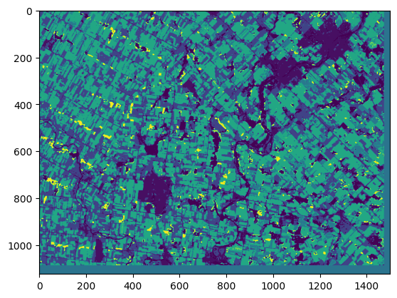
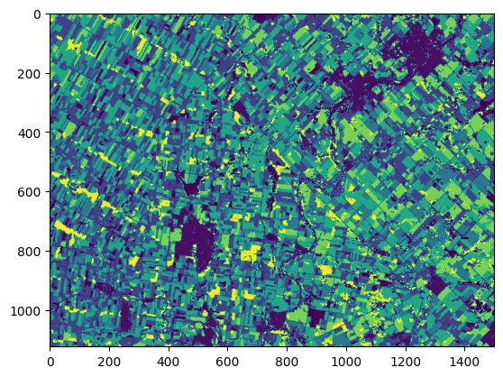
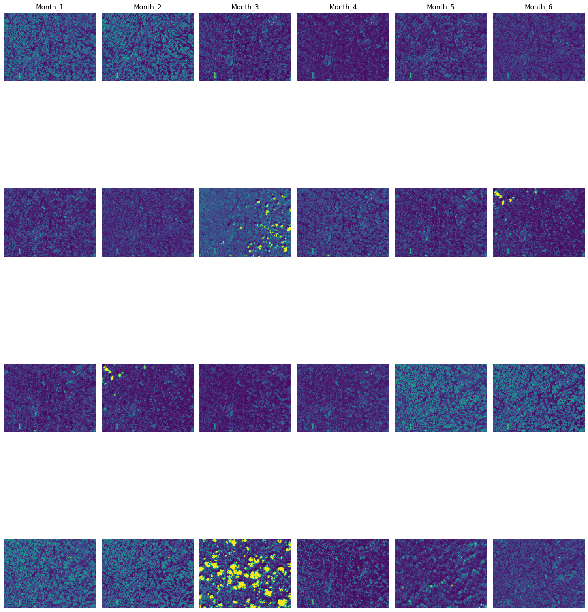
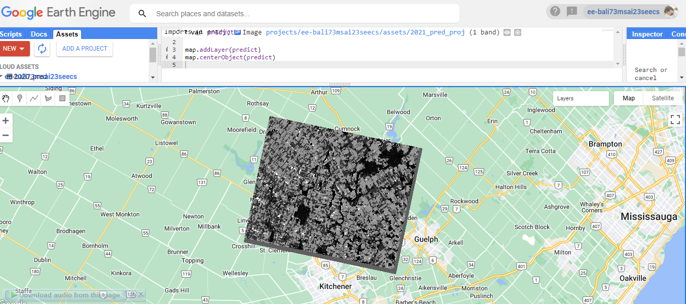

# Time-Series-Based Crop Type Mapping with Sentinel-2

Pixel-wise crop-type mapping of Ontario farmland from a **six-month Sentinel-2 time series**, using a U-Net that shares 2D convolutions across months and pools over time. The model learns crop signatures from 2018–2019, is validated on 2020, and generates a crop map for 2021. The map is exported as a GeoTIFF and visualised in Google Earth Engine.

<p align="center">
  
  
  <br><em>Predicted 2021 crop map (left) and 2021 ground truth (right)</em>
</p>

## Problem and Motivation

Crop-type maps support agricultural monitoring, yield estimation and land-use planning. From a single satellite image, many crops are hard to tell apart. Over a season, each crop follows its own growth cycle, so its spectral signature changes in a characteristic way. This project models that signature with a monthly time series covering the growing season (May–October) instead of classifying single dates.

The work was done as the course project for **CS 878 Deep Learning** (NUST SEECS, Fall 2023). The brief: download Sentinel-2 data for a given farmland region, learn crop signatures from 2018–2020, and produce a crop-type map for 2021.

## Data

| Data | Details | Source |
|---|---|---|
| **Sentinel-2 L2A imagery** | 12 spectral bands at 20 m, one least-cloud mosaic per month (May–October) for 2018, 2019, 2020 and 2021: 24 images of 1500 × 1124 px | [Sentinel Hub Process API](https://www.sentinel-hub.com/) via the `sentinelhub` Python package |
| **Ground-truth crop maps** | One raster per year (2018–2021), 30 m, Albers Equal Area projection, reclassified into 7 classes | Supplied with the course project (not included in this repository) |

**Area of interest:** about 30 km × 22 km of farmland north of Kitchener–Waterloo and Guelph, Ontario (lon −80.687 to −80.314, lat 43.531 to 43.731).

**Classes**

| Code | Class | Code | Class |
|---|---|---|---|
| 0 | Others | 150 | Corn |
| 10 | Land / built-up | 200 | Soybean |
| 50 | Pastures | 250 | Broadleaf |
| 100 | Wheat | | |

<p align="center">
  
  <br><em>Monthly composites (band B04) as plotted in the notebook. Bright blobs are residual clouds.</em>
</p>

## Approach

1. **Data acquisition.** For each month from May to October in each year, a Sentinel Hub request returns a 12-band L2A composite. Scenes are ordered by cloud cover (`leastCC` mosaicking), so each pixel comes from the least cloudy scene available.
2. **Label alignment.** Each yearly ground-truth map is reprojected with nearest-neighbour resampling onto the Sentinel-2 grid, cropped to its labelled extent, and saved as a single-band raster that matches the 1124 × 1500 image grid.
3. **Temporal stacking.** The six monthly composites of a year are stacked into a `(6, 1124, 1500, 12)` cube: months × height × width × bands.
4. **Patching.** Cubes and masks are tiled into non-overlapping 64 × 64 patches, 391 per year. Class codes are remapped to indices 0–6 and one-hot encoded.
5. **Temporal split.**

   | Split | Year(s) | Samples |
   |---|---|---|
   | Train | 2018, 2019 | 782 patches |
   | Validation | 2020 | 391 patches |
   | Test | 2021 | 391 patches |

6. **Model: spatio-temporal U-Net** (2.29 M parameters)
   - The encoder applies the same 2D convolutions to every month (`TimeDistributed`). It has three levels with 32/64/128 filters and a 256-filter bottleneck.
   - Skip connections and the bottleneck are collapsed over time with `MaxPooling3D((6, 1, 1))`, which keeps each feature's strongest response over the season.
   - A standard 2D U-Net decoder (transposed convolutions and skip concatenation) ends in a 7-class softmax.
7. **Training.** Categorical cross-entropy, Adam (default learning rate), batch size 2, 10 epochs. The checkpoint with the best validation accuracy is saved.
8. **Inference and export.** 2021 patches are predicted, mapped back to class codes, re-assembled into the full scene, written to a GeoTIFF and loaded into Google Earth Engine.

## Results

All numbers below are taken from the recorded notebook outputs.

| Split | Pixel accuracy | Loss |
|---|---|---|
| Train (2018–2019), epoch 10 | 0.490 | 1.289 |
| Validation (2020), best epoch (5) | 0.490 | 1.422 |
| Test (2021) | **0.409** | 1.454 |

- The test score uses the final-epoch weights held in memory, not the best checkpoint.
- Keras also logged a `MeanIoU` of 0.4286 on every split and every epoch. That value is an artefact: the metric received one-hot targets and probabilities instead of class labels, which makes it a constant 3/7. It isn't a real IoU, so it's left out of the table.
- The predicted map reproduces the field layout and the large homogeneous areas, but it favours a few classes. In the exported GeoTIFF, corn (150) and pastures (50) cover about 70 % of the pixels, and soybean (200) is almost never predicted.

<p align="center">
  
  <br><em>Predicted 2021 map loaded as an asset in Google Earth Engine</em>
</p>

**Output file:** [`results/2021_pred_proj.tif`](results/2021_pred_proj.tif) is the predicted 2021 crop map: a single-band GeoTIFF of 1137 × 933 pixels, uint8 class codes, 30 m Albers Equal Area grid, about 1.0 MB.

### Limitations and possible improvements
- Accuracy is modest after only 10 epochs, and the input bands aren't normalised. Normalisation, longer training and learning-rate tuning are natural next steps.
- Per-class metrics (IoU, F1) computed correctly, for example with `tf.keras.metrics.OneHotMeanIoU`, would show which crops are confused.
- 2020 could be added to the training data, as the brief allowed.
- The scene borders (36 rows and 28 columns) aren't covered by the 64 × 64 patches. They are filled with a placeholder value (≈ 96, not a valid class), so overlapping or padded tiling is needed.
- The prediction is written into the ground-truth raster's grid without reprojection, so the exported map's georeferencing is approximate.

## Tech Stack

- **Language:** Python 3.10 (Google Colab, GPU runtime)
- **Deep learning:** TensorFlow / Keras
- **Remote sensing and GIS:** sentinelhub, rasterio (GDAL), tifffile, Google Earth Engine (visualisation)
- **Data processing:** NumPy, patchify, scikit-image, SciPy, OpenCV, Pillow, natsort
- **Visualisation:** Matplotlib

## Setup and Usage

```bash
git clone https://github.com/BasharatWali/Time-Series-Based-Crop-Type-Mapping.git
cd Time-Series-Based-Crop-Type-Mapping
pip install -r requirements.txt
jupyter notebook notebooks/Time_Series_Based_Crop_Type_Mapping.ipynb
```

The notebook was written for Google Colab. Before running it:
1. **Sentinel Hub credentials:** create an OAuth client in the Sentinel Hub dashboard and enter its ID and secret in the configuration cell.
2. **Ground-truth maps:** place the yearly crop-type rasters as `/content/ground_data/2018.tif` … `2021.tif`. They aren't distributed with this repository.
3. **Missing imports:** add `import tensorflow as tf`, `from tensorflow import keras` and `from tensorflow.keras import layers` before the model cell; this version of the notebook doesn't import them.
4. **Google Drive:** mount Drive (or change the paths), because the checkpoint and the GeoTIFF are written to `/content/drive/MyDrive/Dl_Assignment/`.

## Project Structure

```
Time-Series-Based-Crop-Type-Mapping/
├── notebooks/
│   └── Time_Series_Based_Crop_Type_Mapping.ipynb  # Download, preprocessing, model, training, evaluation, export
├── docs/
│   └── Course_Project_Brief.pdf                   # Course project description (CS 878, NUST)
├── results/
│   └── 2021_pred_proj.tif                         # Predicted 2021 crop map (GeoTIFF)
├── assets/                                        # Figures for this README
│   ├── prediction_2021.png
│   ├── ground_truth_2021.png
│   ├── sentinel2_monthly_composites.png
│   └── earth_engine_visualisation.png
├── requirements.txt
├── .gitignore
└── README.md
```

## Author

**Basharat Ali**, National University of Sciences and Technology (NUST), Islamabad. Course project for CS 878 Deep Learning (Fall 2023), instructor Dr. Muhammad Moazam Fraz.
